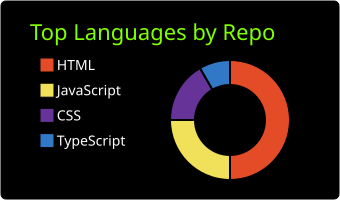
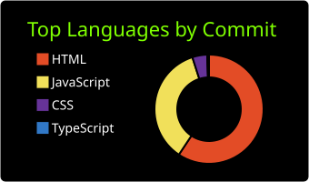
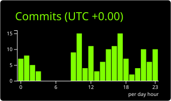
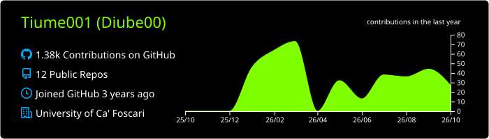
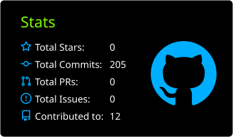

# 👨‍💻 Mattia Scarpa (Tiume001)

> 🎓 Computer Science Student @ **Università Ca' Foscari Venezia**  
> 🌐 Portfolio: [mattiascarpa.it](https://mattiascarpa.it/) | 🐙 GitHub: [github.com/Tiume001](https://github.com/Tiume001)

---

## ⚡ Global & Commit Statistics

  
  

  

  

---

## 📊 Comprehensive Language Analytics

### 🔹 Most Used Languages (Overall Volume & Distribution)

  
  

### 🔹 Languages by Activity & Density (Commits vs Codebase)

  
  

### 🔹 Niche & Less Frequently Used Languages (Tail Stack)
> Mostra le tecnologie di supporto, script secondari o linguaggi usati meno frequentemente nei repository (escludendo i 4 linguaggi dominanti).

  

---

## 🕒 Recent Activity & Time-Tracking (WakaTime)

<!-- START_SECTION:waka -->

  

<!-- END_SECTION:waka -->

---

## 🗂️ Account Profile Deep-Dive

  

  

---

## 🌐 Deployments & Repositories

| Progetto | Descrizione | Live Demo | Sorgente |
| :--- | :--- | :---: | :---: |
| 🕹️ **Web Games** | Arcade e minigiochi in JavaScript / Canvas | [Demo](https://tiume001.github.io/web-games/sito_principale/) | [Repo](https://github.com/Tiume001/web-games) |
| 🏋️ **Gym Tracker** | Tracker per sessioni, esercizi e carichi | [Demo](https://tiume001.github.io/gym-tracker/) | [Repo](https://github.com/Tiume001/gym-tracker) |
| 📚 **University Notes** | Appunti e dispense del corso di laurea | [Demo](https://tiume001.github.io/Notes/) | [Repo](https://github.com/Tiume001/Notes) |
| 🍷 **Natural Wines** | Carta digitale per catalogo vini | [PDF](https://tiume001.github.io/NaturalWines/Vini-3.pdf) | [Repo](https://github.com/Tiume001/NaturalWines) |
| 🛍️ **Nikez Shop** | Concept store su WordPress | [Link](https://tiumex.wordpress.com) | — |
| ☁️ **Cloud App** | Node deployment su Render | [Link](https://test01-dn4r.onrender.com) | — |
